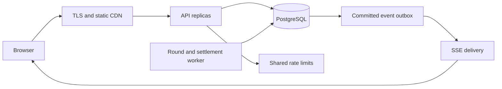

# Colour Club: product, rules and production plan

Implementation update, 10 November 2026: PostgreSQL storage/migration, admin dashboard and blocking, authenticator elevation, verification/recovery, professional interface and deployment packaging are now implemented. README.md, LAUNCH.md and the current verification section supersede the historical local-demo status below. Public deployment, external mail/hosting setup, independent security/load review and legal approval remain unresolved. No real-money functionality is enabled.

Prepared 7 November 2026. This document distinguishes the working local implementation from proposed public-launch work. No public capacity or availability claim is implied.

## 1. What WinGo is, and what this app will be

WinGo is a timed prediction game: each round ends with a number from 0 to 9, and participants select a colour, exact number, or number range before the cutoff. The supplied Jai Club guide lists 30-second, 1-minute, 3-minute and 5-minute versions. That website explicitly describes itself as an independent affiliate guide, not the official platform. Its claims do not establish how Jai Club's private server chooses outcomes. [Source: supplied guide](https://jaiclubgameofficial.com/).

Colour Club is an independently implemented free-points simulation. It has its own name, interface and published rules. It is not an investment product or a source of financial returns. No payment, prize, purchase, transfer, redemption or withdrawal exists in this phase.

The requested result policy is implemented openly: choose the outcome with the lowest aggregate payout, with random tie-breaking. A statement above the board, the game rules and the signup acknowledgement disclose this. Do not describe this mode as fair independent randomness, provably fair, trading, investing, or a way to earn money.

## 2. Decisions and source conflicts

The attachment was treated as reference material, not instructions. The user's direct request controls the product. These conflicts have been resolved for v1:

| Topic | Direct request | Attachment | Decision |
|---|---|---|---|
| 0 and 5 | Violet only | Red/Violet and Green/Violet | Violet only |
| Rooms | 30s, 1m, 3m, 5m | 1m and 3m | All four |
| Outcome | House maximises surplus | Independent random number | Disclosed minimum-payout selector |
| Credit | 10,000 free points | Virtual or real currency | 10,000 nonredeemable points |
| Fee | Not specified | 2% | No additional fee |
| Lock | Not specified | Final 10 seconds | Final 5 seconds in every room |
| Returns | Exact number highest | 2×, 4.5×, 9× and combo returns | Proposed table below, no combos |
| Big/Small return | Not specified | Not specified | Proposed 1.9× |

The payout table and lock duration are explicit implementation assumptions, not a claim that Jai Club uses them. A rule change must create a new version and apply only to future rounds.

## 3. Exact game contract

### Number mapping and gross returns

| Selection | Winning numbers | Gross return per point staked | Hypothetical uniform-draw return rate |
|---|---|---:|---:|
| Green | 1, 3, 7, 9 | 2.0 | 80% |
| Red | 2, 4, 6, 8 | 2.0 | 80% |
| Violet | 0, 5 | 4.5 | 90% |
| Exact number | One chosen number | 9.0 | 90% |
| Small | 0, 1, 2, 3, 4 | 1.9 | 95% |
| Big | 5, 6, 7, 8, 9 | 1.9 | 95% |

Gross returns include the stake. A 100-point winning Red prediction credits 200, so its net result is +100; a loss credits zero, so its net result is -100. There is no separate stake refund. These percentages are mathematical averages under a hypothetical uniform draw, **not the actual win probabilities or actual return rate in this house-controlled mode**.

One result settles every bet in a room. Overlapping selections are additive: a bet on Green, one on number 1 and one on Small may all win on result 1. The selector must count all three.

### Stake and account rules

- Grant exactly 10,000 points once per newly created email account, in the same transaction as account creation.
- Keep balances in integer hundredths of a point. Accept base stakes only as whole points, 1–1,000.
- Stake multipliers: 1, 5, 10, 20, 50, 100. Total stake = base × multiplier; maximum 10,000 per submission.
- A multiplier multiplies the stake, not the payout rate or likelihood of winning.
- Block Red + Green, Big + Small, and more than seven distinct number selections across all the account's submissions in one room/round.
- Repeating a selected number is allowed. Maximum 100 submissions per account per round. Apply rate limits independently.
- Restrictions are per account, room and round. Different rooms remain independent. Multiple accounts can bypass account-level restrictions; prevention requires an identity/abuse programme, not only a database check.
- No cancellation after an accepted submission. A failed request must leave the balance unchanged.
- No automatic refills. A zero-balance account can inspect history; a future refill programme would need explicit limits and a unique grant key.

### Round lifecycle

Round IDs are `durationSeconds-epochStartMilliseconds`. Boundaries are aligned to UTC epoch multiples, so midnight and local daylight-saving changes do not create duplicate periods. Show readable timestamps in the visitor's local timezone.

1. OPEN: `start <= server time < lock`; accept valid predictions.
2. LOCKED: `lock <= time < end`; reject new predictions. A retry of an already accepted request returns the existing record.
3. SETTLEMENT: freeze the accepted pool, calculate all ten liabilities, choose one minimum, credit returns and save the audit in one transaction.
4. SETTLED: immutable result and returns; the next epoch-aligned round begins.

The local server checks every 500 ms. Browser polling is every two seconds, and the browser animates its countdown from the last server timestamp. The server's cutoff decides acceptance, not the button state or device clock. After six seconds without a fresh state, the browser pauses submission.

On restart, settle stored expired rounds before serving normal play. Downtime intervals with no created rounds are skipped; do not manufacture a result history for periods when the service was absent. Continuous public operation requires an always-on host, process supervision and monitoring; a sleeping laptop does not provide it.

## 4. House result engine and the meaning of 'always win'

For a round, let `S` be total stakes and `L(n)` be the sum of gross winning payouts if the result is `n`.

```text
For n = 0..9:
    L(n) = sum(payout(bet, n) for every accepted bet)
minimum = min(L(0), ..., L(9))
candidates = all n for which L(n) = minimum
result = candidates[cryptographically_random_index(candidates.length)]
house_point_surplus = S - L(result)
```

Use exact integer arithmetic for liability comparison. Tie means equal total payout, not equal stakes per colour. Only choose among tied minima; if all ten match, all ten are eligible. Node's `crypto.randomInt` avoids modulo bias in selecting a bounded integer. [Node crypto documentation](https://nodejs.org/api/crypto.html#cryptorandomintmin-max-callback).

### Your example

| Stakes | Value |
|---|---:|
| Red | 1,000 |
| Green | 2,000 |
| Violet | 500 |
| Total S | 3,500 |

| Candidate results | Gross liability | House point surplus |
|---|---:|---:|
| 2,4,6,8 (Red) | 2,000 | 1,500 |
| 1,3,7,9 (Green) | 4,000 | -500 |
| 0,5 (Violet) | 2,250 | 1,250 |

Pick randomly from 2,4,6,8. Choosing Violet merely because its stake pool is smallest would miss the better house outcome.

### Why this specific payout table guarantees a point surplus

For every individual bet in this table, its average payout across the ten possible outcomes is at most 95% of its stake. Summation preserves that inequality:

```text
(L(0) + ... + L(9)) / 10 <= 0.95 × S
min(L(n)) <= average(L(n))
therefore S - min(L(n)) >= 0.05 × S
```

This holds for arbitrary mixtures of colours, numbers and ranges, including opposing bets placed by different accounts. Payout rounding down cannot weaken the bound. An empty round has zero surplus. The implementation tests the individual bounds and 500 generated mixed portfolios.

The guarantee is narrowly about **round point accounting with this fixed table**. It is not a promise of financial profit; free issued credits produce no income and hosting still costs money. Changing odds, adding bonuses, paying rewards outside the table, or granting redeemable value requires a fresh analysis. Do not silently swap to different rules to preserve a desired margin.

### Product consequence

A lone player placing just one selection will usually lose every time, because some other number has zero liability. This is a direct consequence of the requested policy. More participants do not make it an independent draw. Run a small user study to see whether the openly disclosed simulation is enjoyable. If the product objective later becomes a conventional fair free-play game, replace this policy with an independent draw and accept that individual rounds may favour players; that is a separate product decision, not a hidden switch.

## 5. What is implemented now

| Area | Current delivery | Boundary |
|---|---|---|
| Interface | Responsive board, slip, rule/privacy dialogs, history, wallet and audit | One original light theme |
| Identity | Email/password registration, login/logout, hash storage, sessions | No verification or recovery |
| Points | One-time grant, conditional debit, ledger, credits | Free points only; account not person identity |
| Round engine | Four rooms, authoritative cutoff, restart recovery | Single Node process |
| Settlement | Ten-outcome liability calculation, tie RNG, atomic credits | Rules version v1 only |
| Network | Same-origin JSON endpoints, polling and retry key | No distributed event stream |
| Security | Salted scrypt, hashed session tokens, HttpOnly cookies, origin checks, parameterised SQL, CSP, body/rate limits | No external penetration test or public edge protection |
| Verification | Rules, boundary, rollback, idempotency, persistence and HTTP tests | No certified public-load result |

The app has no runtime npm dependencies. Node 24 supplies HTTP, cryptography, SQLite and testing; the browser supplies standard forms and dialogs. The installed Node version successfully ran the app and tests. The built-in SQLite API is documented by Node; check the selected runtime's release status when pinning the production image. [Node SQLite documentation](https://nodejs.org/api/sqlite.html).

## 6. Recommended production stack

Start as one modular application with a separate worker process. Do not begin with many microservices or Kubernetes.

| Layer | Recommended public-launch choice | Why / when |
|---|---|---|
| Client | Keep this browser UI initially; introduce TypeScript/React only when account and admin flows justify it | Frontend framework choice does not solve settlement correctness |
| Runtime/API | Supported, pinned Node LTS; TypeScript; Fastify for the expanded API | Schema validation and maintainable routes as the API grows |
| Durable store | Managed PostgreSQL with point-in-time recovery | Multi-instance transactions, row locks, backups |
| Worker | Same codebase, independent always-on process | Can restart/redeploy API without stopping settlement |
| Live delivery | SSE over HTTP/2, plus REST submissions | Only server-to-browser events are needed; no per-second countdown messages |
| Shared coordination | PostgreSQL leases initially; add Redis for shared rate limits and event fan-out as replicas grow | Redis must not become the authoritative wallet or result store |
| Static delivery | CDN with content-hashed frontend assets | Cache static files, never private account responses |
| Deployment | Containerised API and worker behind TLS; managed database in the same region | Controlled rollout and low transaction latency |
| Monitoring | Structured logs, metrics, error reporting and on-call alerts | Observe failed/late settlements and reconcile balances |
| Testing | Native rule tests, PostgreSQL integration tests, browser E2E and k6/Artillery load tests | Measure actual bottlenecks before scaling |

SQLite allows only one writer at a time and is not the selected store for many application servers writing concurrently. Migration is a required step for the planned public scale, not a promise that the demo already scales horizontally. [SQLite usage guidance](https://www.sqlite.org/whentouse.html).

SSE is one-way delivery and fits result/status updates while submissions remain HTTP requests. Clients reconnect and refetch a current snapshot; serve via HTTP/2 to avoid the small per-origin HTTP/1 connection limit. [MDN SSE guide](https://developer.mozilla.org/en-US/docs/Web/API/Server-sent_events/Using_server-sent_events).



## 7. Production data and transaction design

### Durable tables

| Table | Essential keys and fields |
|---|---|
| users | UUID, normalised email unique, verified_at, status, created_at |
| credentials/sessions | user_id, password hash or identity-provider reference, hashed token, expiry, revocation |
| wallets | user_id unique, balance BIGINT nonnegative, version |
| ledger_transactions / entries | transaction ID, reference unique, account, signed units, reason, created_at |
| rulesets | immutable version, mapping, multipliers, limits, result policy, effective_at |
| rooms | duration, active ruleset, pause state |
| rounds | room/start unique, opens_at, locks_at, ends_at, status, result, ruleset_id, settlement ID |
| bets | user, round, choice, stake, accepted_at, request key unique per user, status, payout |
| round_audits | ten liabilities, chosen candidate, candidate set, total stake, total payout, policy version |
| outbox | event ID unique, aggregate ID, sequence, payload, created_at, published_at |
| admin_audit | actor, action, before/after reference, reason, timestamp |

Use BIGINT point units end to end and serialize large amounts as strings if they exceed JavaScript's safe integer range. The local demo uses Number and is deliberately bounded per request, but that is not a global production lifetime bound. A PostgreSQL migration must use safe BigInt handling for aggregate pools and balances.

Public history contains aggregate figures only. Never expose identities, IPs, password hashes, session tokens or private predictions. Index `(room_id,start DESC)`, `(user_id,created_at DESC)`, `(round_id,status)`, unique request keys and pending round lookup. Add time partitions only when table size, retention and query evidence justify them.

### Prediction acceptance transaction

1. Authenticate and validate the JSON shape and numeric bounds; derive user identity from the session only.
2. Begin a transaction. Fetch/replay an existing matching request key; reject reuse with different content.
3. Lock the round row, then the user's wallet in a consistent order. Verify current database time is before lock and the round is OPEN. Use a database time function that measures actual check time after lock waiting, not the transaction-start timestamp.
4. Re-read all of that user's selections for the round. Enforce restrictions and count limits while serialised for that wallet.
5. Debit conditionally: `UPDATE wallets SET balance=balance-stake WHERE ... AND balance>=stake`.
6. Insert bet, balanced ledger entries and acknowledgement/outbox event. Commit together.
7. Return the immutable accepted record. On connection loss, retry the same key. Never invent a new key just because the response timed out.

### Settlement transaction and concurrency

1. A worker finds expired rounds. Lock one with `FOR UPDATE SKIP LOCKED`; a second worker must not settle it simultaneously.
2. Confirm it has no saved result and freeze its accepted set. All acceptance transactions use the same round lock, preventing late inserts.
3. Calculate liabilities from accepted bets using that round's immutable ruleset; persist the chosen result once.
4. Lock affected wallets in deterministic order, then credit all returns and write ledger entries using unique `settlement:betId` keys.
5. Mark the round settled and insert its outbox events in the same transaction.
6. Publish only after commit. Duplicate event delivery is acceptable; clients deduplicate by event ID and refetch authoritative state.

PostgreSQL row locks can block conflicting operations, and consistent lock acquisition reduces deadlocks. Retry bounded deadlock/serialization failures using the same business request identity. [PostgreSQL explicit locking](https://www.postgresql.org/docs/current/explicit-locking.html).

For larger pools where one settlement transaction becomes too long, keep result selection atomic, then credit resumable batches with unique ledger keys. Expose `SETTLING` until all credits reconcile; do not announce balances as final early. This batching is a measured optimisation, not implemented in the local demo.

### Accounting invariants

- A wallet never becomes negative.
- A request key has at most one accepted bet and one debit.
- Every accepted bet is settled once or explicitly voided/refunded once.
- Reconstruct every wallet from its ledger; the reconstructed total equals the stored balance.
- Production double-entry transactions sum to zero, including grant, escrow and house accounts.
- Sum of individual credits equals the selected round liability.
- `stake pool - gross returns = house point surplus` for each settled round.
- Result and ruleset cannot change after settlement. Corrections use explicit compensating ledger entries, never silent edits.

## 8. API and live events

Current endpoints:

| Endpoint | Behaviour |
|---|---|
| `POST /api/register` | Name, email, password, disclosure acknowledgement; create account and grant |
| `POST /api/login` | Start/rotate a cookie session |
| `POST /api/logout` | Revoke session and clear cookie |
| `GET /api/state?room=30` | Current round, public history, aggregate pool, and authenticated user's data |
| `POST /api/bets` | Round ID, selection, base, multiplier, idempotency key |
| `GET /api/health` | Round processor health |

For production split public room snapshots from private wallet/bet reads. Add cursor pagination, `/me`, `/wallet/entries`, `/bets`, `/rounds/:id/audit`, email verification/recovery and an SSE endpoint. Version the contract before external integrations. Give errors stable codes such as `ROUND_LOCKED`, `INSUFFICIENT_POINTS`, `OPPOSING_SELECTION`, `REQUEST_CONFLICT`, and `TEMPORARILY_UNAVAILABLE`.

Broadcast `round.opened`, `round.locked`, `round.settled` and private wallet events after commit. Send timestamps; browsers render the ticking clock locally. Reconnection with an expired event cursor must trigger a fresh state fetch. Polling remains a fallback with backoff and jitter, not a permanent two-second full-history fetch at large scale.

## 9. UI and player flows

The board, countdown and prediction slip take precedence over marketing. A warm ivory/ink base makes actual Red, Green and Violet selections distinct. Number text and explicit labels make colour nonessential to understanding the result.

Implemented flow:

1. Visitor can inspect rooms, rules, histories and result audits without an account.
2. Register with display name, email and password; acknowledge the outcome policy and free-point nature.
3. Receive the one-time balance. Choose a room and selection, set base and multiplier, inspect stake/return, submit.
4. See success or a specific rejection. No debit on a rejected prediction.
5. Wait through the locked period; see the next round, prior result, own return and point activity.
6. Inspect any recent result's ten candidate payouts and the tie set.

Production additions: verified onboarding, password recovery, accessible account settings/deletion, longer paginated history, session revocation, rate-limit recovery UX, and a support contact. Do not add fake winners, fabricated activity, misleading profit charts, countdown pressure offers, confetti for losses, or near-miss manipulation.

On mobile, the selection board is followed by the confirmation slip, then history, so users do not need to scroll past history to confirm a pick. Touch targets must remain at least 44px, modal focus must be trapped, Escape closes dialogs, and reduced-motion preferences must be respected.

## 10. Security and abuse controls

Current hashes use scrypt with a per-account random salt, N=131072, r=8, p=1; hashes are not reversible encryption. These parameters match one of OWASP's recommended scrypt configurations. Public rollout should benchmark the cost and cap concurrent authentication work; prefer a mature identity service or well-tested authentication library for recovery and account security. [OWASP password storage](https://cheatsheetseries.owasp.org/cheatsheets/Password_Storage_Cheat_Sheet.html).

Session tokens are random, stored hashed on the server, and carried in HttpOnly/SameSite cookies. Production requires HTTPS and Secure cookies; origin validation complements, but does not replace, the overall CSRF design. Rotate sessions on login and revoke on logout; add account-level revocation and idle expiry before launch. [OWASP session management](https://cheatsheetseries.owasp.org/cheatsheets/Session_Management_Cheat_Sheet.html).

Before inviting real users:

- Verify email ownership. Define whether the grant is per verified account or per person; do not claim person uniqueness without a supported identity process.
- Use shared account and trusted-client-IP rate limits. Only trust forwarded IP headers from your configured proxy; never blindly trust arbitrary client headers.
- Bound body sizes, timeouts, auth concurrency, subscriptions, stake counts and aggregate exposure. Reject malformed inputs at the API boundary.
- Keep secrets out of source and logs; parameterise queries; escape rendered values; apply CSP and clickjacking protection.
- Add admin MFA and least-privilege roles. No client-facing endpoint can set a result or edit balances directly.
- Record admin grants, account suspensions, pauses and refunds with an actor and reason. Prevent manual result rewriting.
- Establish retention, export/deletion, incident response and access auditing. Test backup restoration with anonymised data.
- Determine launch countries and applicable obligations before a public release. Any later addition of paid credits, prizes, cash-out or transferable value is a separate product and legal review. This document does not assert legal approval for any jurisdiction.

## 11. Reliability, operations and scaling

### Measure before expanding

Suggested **test targets**, not achieved capabilities: begin with 100 concurrent browsers, then 1,000; 10 then 100 accepted submissions/second, including bursts just before lock. A two-second full-state poll creates approximately `concurrent visible clients / 2` requests per second: 1,000 clients means about 500 reads/second before submissions. This motivates public/private snapshot separation and SSE.

At 1,000 active users, one prediction every 30 seconds per user creates about 2.88 million bets/day. Size data retention, indexes and backups from actual rows and measured storage, not just registered-account count. Most applications have far fewer simultaneously active players than registered accounts; use measured concurrency.

### Proposed acceptance targets

- Normal prediction p95 response under 300 ms in the target region, excluding signup hash work.
- Settlement visible within two seconds of end for the initial target pool size.
- Zero duplicate debits/credits in retries, failovers and concurrency tests.
- Zero unreconciled wallet/ledger differences.
- No late acceptance after the server-side cutoff under artificial latency.
- Reconnect restores current round and wallet within five seconds after the network returns.
- A reviewed recovery target, for example RPO five minutes and RTO thirty minutes, proven by a restore drill rather than assumed from provider marketing.

### What to observe

Metrics: request latency/error rate, auth queue, database lock time, transaction retries, event-loop delay, overdue rounds, settlement time, uncredited bets, outbox backlog, SSE reconnects and reconciliation differences. Alert immediately on a balance invariant failure or contradictory settlement; alert on persistent overdue rounds and backup failures.

Readiness checks database reachability and settlement lag; liveness checks process responsiveness. Logs include request, user surrogate, round and bet IDs without passwords, session values or complete request bodies. Synchronise server clocks and alert on drift; monotonic time is useful for measuring elapsed durations, while durable round boundaries use UTC.

### Deployment and incident behaviour

- Separate development, staging and production databases and secrets. Run versioned migrations, tests and a staging smoke test in CI.
- Deploy one small always-on service and worker first. Avoid hosts that routinely sleep or stop background workers.
- During releases, drain submissions and finish in-flight transactions. Maintain backward compatibility with unsettled ruleset versions.
- If settlement is unhealthy, reject new bets with an explicit message; never acknowledge a bet without a durable commit.
- Restart retries committed work safely. A failed notification must not undo credited points.
- Use PostgreSQL backups/PITR, encrypted storage and a restoration exercise. Keep a rollback image and backwards-compatible schema changes.
- Scale API/SSE replicas separately from workers. Add replicas only after transactional coordination and shared limits work.

## 12. Test and launch checklist

Automated correctness coverage should include every payout for all ten numbers; sums of overlapping bets; empty and tied pools; restrictions across separate requests; eighth number; every multiplier; invalid/malformed stakes; exact lock boundary; changed client clock; duplicate key same/different payload; two simultaneous debits against the last points; two workers settling one round; failure before/after commit; offline restart; session expiry/revocation; unverified and duplicate registration; public/private data separation; and ledger reconstruction.

The local suite covers the pure rules, generated portfolio bound, important transaction paths, injected debit rollback, restart persistence and HTTP sessions. PostgreSQL worker contention, real network loss, distributed load, external security review and full assistive-technology testing remain launch work. See VERIFICATION.md for what was actually run.

Rollout gates:

1. **Local demo:** verify rule choices, visual flow and disclosed house behaviour. Working deliverable in this repository.
2. **Private alpha:** managed PostgreSQL, migrations, verified identity/recovery, restricted tester access, scheduled reconciliation and backups. No real-value features.
3. **Public free-play pilot:** TLS/CDN, shared limits, SSE, operator controls, support/privacy/deletion workflows, launch-region review, load/security/accessibility checks.
4. **Measured growth:** expand capacity only after observing p95 latency, settlement lag, lock contention and retained data. Partition or batch when measurements justify it.

Indicative engineering sequence for one experienced developer, **estimates not a delivery commitment**:

| Workstream | Rough effort | Exit evidence |
|---|---|---|
| Confirm rules and UX with a small test group | 1–2 days | Published rule table and understandable disclosure |
| PostgreSQL migration, locking and ledger hardening | 3–5 days | Concurrent acceptance and settlement integration tests |
| Identity, recovery and operator tools | 3–5 days | Verified grants, revoked sessions and audited admin actions |
| SSE, reconnect and deployment | 2–4 days | Reconnect/failover exercise and staged release |
| Load, abuse, accessibility and restore drills | 3–5 days | Recorded results against agreed targets |
| Pilot and fixes | 1–2 weeks elapsed | Real usage observations and incident review |

Vendor prices and a monthly cost estimate are intentionally not invented. Choose a region, concurrent-user target, retention window and backup/recovery requirement, then obtain current quotes for the API/worker, managed database, cache if needed, email and monitoring.

## 13. Reverse-engineering research conclusion

The suggested [REA project README](https://github.com/morluto/rea/blob/main/README.md) describes tools for inspecting binaries, JavaScript/Electron applications and observed runtime behaviour. Its existence does not provide Jai Club's private server logic. No authorised app binary or source package was supplied, and the requested rules are already enough to implement this independent simulation.

REA was reviewed but not installed or executed. No competitor app, private API, authentication boundary or backend was accessed. If later evaluating a user-owned app, scope that inspection to the supplied artefact and distinguish observed frontend behaviour from inferred server logic. Do not claim an extracted algorithm without evidence.

## 14. Scope intentionally omitted

No real money, crypto, withdrawals, purchases, redeemable points, referral rewards, leaderboards, chat, native app packaging, opaque result overrides, microservices or unnecessary frontend dependencies. These are not needed to demonstrate the requested core. Public deployment and the production work above remain separate from the running local prototype.
